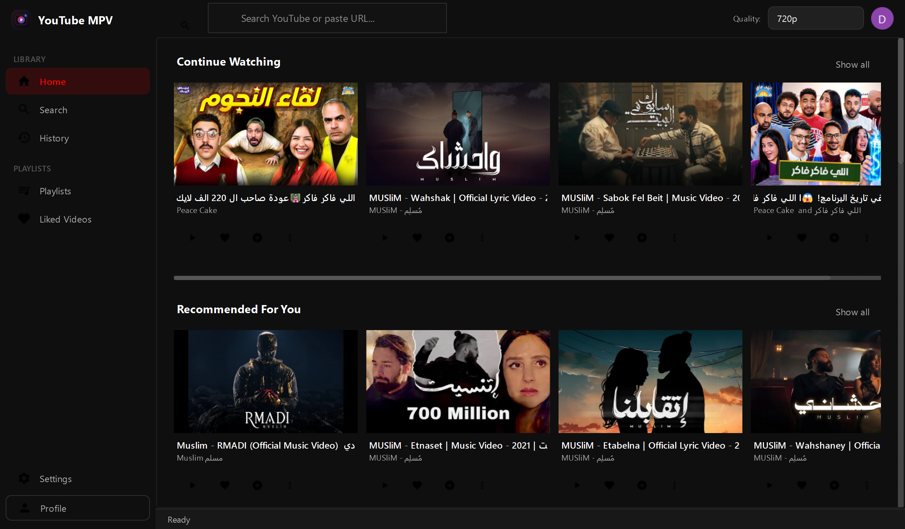
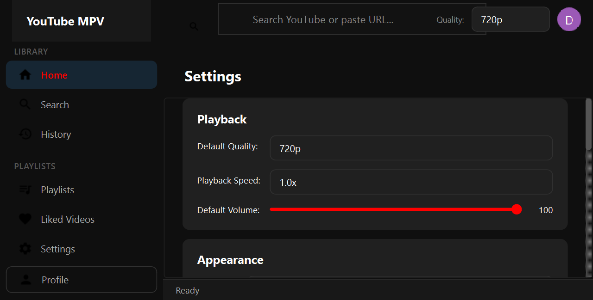
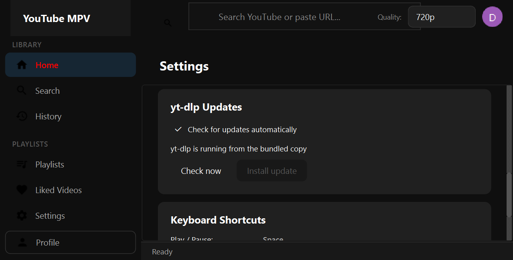

<div align="center">
  
  <h1>YouTube MPV Player</h1>
  <p><strong>A lightweight, privacy-first desktop YouTube player built on MPV and yt-dlp.</strong></p>
  <p>Search, stream and organise YouTube locally — no browser, no ads, no API keys, no Google account.</p>

  <p>
    <a href="https://github.com/raoufLR/YouTube-MPV-Player/actions/workflows/ci.yml"></a>
    
    
    
    
    
  </p>

  
</div>

---

**YouTube MPV Player** is a native desktop client for YouTube. It talks to YouTube through
[yt-dlp](https://github.com/yt-dlp/yt-dlp) for search and stream resolution, and hands playback to
[MPV](https://mpv.io/) — a small, fast, GPU-accelerated player. Everything else lives in plain JSON on
your disk: history, likes, playlists, subscriptions and viewing statistics. Nothing is uploaded, and no
Google Cloud project or OAuth login is involved.

> Prefer a ready-made binary? Download the portable Windows build from the
> [latest release](https://github.com/raoufLR/YouTube-MPV-Player/releases/latest).

## Why this player

- **Fast on low-end machines.** No Chromium, no Electron, no ads or trackers — MPV does the decoding.
- **Your data stays yours.** Per-profile JSON stores, no telemetry, no account required.
- **Bring your existing library.** Import playlists, likes, watch history and subscriptions straight
  from a [Google Takeout](#-import-your-google-takeout-archive) archive.
- **Built like an application, not a script.** Event-driven services, thread-marshalled UI updates,
  a test suite of 631 tests, and Ruff-clean code.

---

## Screenshots

| Home feed | Settings | yt-dlp updates |
|-----------|----------|----------------|
|  |  |  |

---

## ✨ Features

### Playback & discovery

- **Search** — full-text YouTube search via yt-dlp with infinite-scroll pagination.
- **Paste a URL** — any YouTube link plays immediately.
- **Quality control** — 360p / 480p / 720p / 1080p / best, including separate DASH video and audio tracks.
- **Reliable resolution** — asynchronous stream resolution with newest-request-wins cancellation, so
  rapid clicks never start the wrong video.
- **Keyboard-first controls** — focus-aware shortcuts that never steal keys from text fields, sliders,
  buttons or lists; hold an arrow key to seek or change volume continuously.
- **Seek preview** — hover the progress slider to see the time under the cursor before you click.
- **yt-dlp updater** — check for and install yt-dlp releases from Settings, with SHA-256 verification
  and an atomic swap of the binary.

### Library & organisation

- **Home feed** — Continue Watching, Recommended, Recently Played and more, loaded asynchronously.
- **Watch history** — automatic, deduplicated, capped at 500 entries, flushed off the GUI thread.
- **Likes & Watch Later** — saved locally, with live state indicators across every page.
- **Playlists** — create, rename and delete playlists; Watch Later is built in.
- **Analytics** — per-profile watch time, videos played, rewatches and most-watched channels; updates
  live and can be reset locally.
- **Multi-profile** — independent settings, history and playlists per profile, with avatars. A failed
  profile switch leaves the current profile intact.

### Data, portability & privacy

- **Google Takeout import** — playlists, liked videos, watch history and subscriptions, selected
  per category, with skip-or-overwrite conflict handling.
- **Data bundles** — versioned export/import of a profile's settings, history, likes, playlists and
  details between installs.
- **Tolerant persistence** — load-time validation repairs malformed JSON, rejects unsafe IDs and keeps
  `.bak` recovery copies.
- **Single instance** — a second launch raises the running window (restoring it if minimized) and
  exits instead of racing the same profile files; a stale lock left by a crash is reclaimed
  automatically.
- **Security boundaries** — thumbnail hosts are allowlisted and size-capped, yt-dlp runs with
  `--ignore-config` and closed stdin, avatars must be local files, and logs redact signed URLs and tokens.

### Look & feel

- **Themes** — Default and YouTube Dark, applied application-wide, including dialogs, menus and message
  boxes, with a single source of truth for colours and metrics.
- **Responsive shell** — collapsible sidebar and a search bar that adapts to the window width.
- **Window state** — size, position and maximized state are restored and clamped to visible screens.
- **Accessible by default** — icon buttons carry accessible names and tooltips; playback shortcuts
  respect focus.
- **Translation-ready** — every user-facing string goes through `ui/i18n.py` (`tr()` / `trn()`), with
  Qt `.qm` catalogues loaded automatically; English is the default.
- **Performance** — cached SVG icons, shared decoded thumbnails, coalesced event bursts, debounced
  async saves and O(1) video lookups.

---

## 📥 Import your Google Takeout archive

Google Takeout is Google's official, free export tool. It can download a complete copy of your YouTube
data — and this app imports it locally, without sending anything anywhere.

1. Open [takeout.google.com](https://takeout.google.com/) and sign in.
2. Click **Deselect all**, then tick **YouTube and YouTube Music**.
3. Create the export and download the `.zip` (usually ready within minutes).
4. In the app, open **Settings → Google Takeout & Data Import → Import from Google Takeout…**.
5. Pick the `.zip` — or an already extracted folder — then review what was detected.
6. Choose the categories to import and whether to skip or overwrite duplicates, then start.

The in-app **💡 How to get Takeout file?** button opens the same guide with step-by-step screenshots of
Google's flow.

| Found in the archive | Imported as |
|----------------------|-------------|
| Liked videos (`Playlists/Liked videos.csv/json`) | Likes |
| Watch Later | Watch Later playlist |
| Custom playlists, including modern per-playlist `… _Title_` folders | Playlists |
| Watch history (JSON or HTML) | Watch history, capped at 500 entries |
| Subscriptions (`subscriptions.csv/json`) | Subscription list |

Notes:

- Both JSON and CSV exports are supported, including non-English folder and file names (for example
  Arabic), and both classic and 2026-style Takeout layouts.
- Missing titles are enriched from watch history and playlist metadata where possible.
- Imports run on a worker thread with per-item cancellation, so **Cancel** stops immediately and the
  dialog can be closed safely at any point.
- Bulk imports publish a single coalesced event per data type, which keeps the UI responsive even with
  tens of thousands of history rows.
- The archive is only read, never modified. Extraction uses a temporary staging directory that is
  removed when the import ends.

---

## ⌨️ Keyboard shortcuts

| Key | Action |
|-----|--------|
| `Space` | Play / pause |
| `←` / `→` | Seek back / forward 10 seconds |
| `↑` / `↓` | Volume up / down |
| `F` or `F11` | Toggle fullscreen |
| `Esc` | Stop playback |

Shortcuts are ignored while you are typing in a text field, dragging a slider, or when a dialog is open.
The complete reference is also available in **Settings → Keyboard Shortcuts**.

---

## 🚀 Quick start

### Requirements

- **Windows 10/11** — the primary target (the codebase itself is portable; CI runs on `windows-latest`)
- **Python 3.14+**
- **`mpv.exe`** — download from [mpv.io](https://mpv.io/installation/)
- **`yt-dlp.exe`** — download from the [yt-dlp releases](https://github.com/yt-dlp/yt-dlp/releases)

Place both executables in the project root (next to `main.py`). The app resolves them from the bundle,
the project directory or `PATH` — never from an untrusted working directory.

### Run from source

```powershell
git clone https://github.com/raoufLR/YouTube-MPV-Player.git
cd YouTube-MPV-Player

python -m venv .venv
.venv\Scripts\Activate.ps1
pip install -r requirements.txt

# Put mpv.exe and yt-dlp.exe in this folder, then:
python main.py
```

On first launch the app creates `User/` and `Cache/`. Each profile lives under
`User/profiles/<opaque-id>/`; legacy `User/<name>/` directories are migrated automatically.

### Build a portable executable

```powershell
pip install -r requirements-dev.txt
python build.py
# Output: dist\youtube_video_player.exe (single file, bundles mpv and yt-dlp)
```

See [BUILD.md](BUILD.md) for signing, icon and release notes.

---

## 🏗️ Architecture

```
main.py ──▶ Application (composition root)
             ├── EventBus / ThreadSafeEventBus   thread-safe pub/sub, weak refs, coalescing
             ├── ServiceContainer                dependency injection for 16 services
             └── MainWindow (PyQt6)
                 ├── SidebarWidget              collapsible navigation
                 ├── HeaderWidget               search field + quality selector
                 ├── NowPlayingBar              transport controls
                 └── Pages
                     ├── HomePage               Continue Watching, Recommended, Recently Played
                     ├── SearchPage             infinite-scroll results
                     ├── HistoryPage            history with context menus
                     ├── PlaylistsPage          playlist CRUD
                     ├── LikedPage              liked videos
                     ├── AnalyticsPage          local playback statistics
                     ├── ProfilePage            profile & avatar management
                     └── SettingsPage           preferences, shortcuts, Takeout import, updates
```

**Principles**

- **Event-driven.** Services publish typed events on the bus; pages subscribe and rebuild only the
  parts they own. Bulk operations can wrap work in `EventBus.coalesced()` so a thousand item writes
  produce one UI refresh instead of a thousand.
- **Thread marshalling.** Background publishers use `ThreadSafeEventBus.publish_to_main_thread()`,
  bridged to Qt signals, so widgets are only touched on the GUI thread.
- **Dependency injection.** `app/service_container.py` wires services in one place, which keeps pages
  testable with fakes.
- **Atomic persistence.** `core/json_store.py` writes through a temporary file, keeps `.bak` copies and
  validates on load.

### Services

| Service | Responsibility |
|---------|----------------|
| **LoggingService** | Centralised logging with URL/token redaction |
| **UserManagerService** | Profile registry, switching and migration |
| **SettingsService** | Preferences (quality, theme, volume, speed, language, updates) |
| **PlayerService** | MPV lifecycle and cached playback state |
| **StreamResolverService** | yt-dlp resolution to direct media URLs (video + optional DASH audio) |
| **PlaybackService** | Async orchestration with newest-request-wins cancellation |
| **SearchService** | YouTube search and pagination via yt-dlp |
| **ThumbnailCacheService** | LRU memory + disk thumbnail cache with allowlisted downloads |
| **UserProfileService** | Display name, avatar and profile metadata |
| **HistoryService** | Watch history (event-driven, async flush, 500-entry cap) |
| **AnalyticsService** | Per-profile watch time, plays, rewatches and channels |
| **LikesService** | Liked videos |
| **PlaylistService** | Playlist CRUD + Watch Later |
| **RecommendationService** | Home-feed recommendations |
| **DataImportService** | Google Takeout inspection and import orchestration |
| **YtDlpUpdateService** | Release checks, SHA-256 verification and atomic binary updates |

---

## 📁 Project structure

```
YouTube-MPV-Player/
├── main.py                     # Entry point (--self-test for a headless smoke test)
├── player.py                   # MPV subprocess wrapper (async IPC, DASH audio)
├── youtube_api.py              # yt-dlp wrapper (search + stream extraction)
├── build.py                    # Canonical PyInstaller build script
├── youtube_video_player.spec   # PyInstaller spec
│
├── app/                        # Bootstrap and dependency injection
│   ├── application.py
│   └── service_container.py
│
├── core/                       # Cross-cutting primitives
│   ├── event_bus.py            # Pub/sub with weak refs and coalescing
│   ├── events.py               # 33 typed event dataclasses
│   ├── json_store.py           # Atomic JSON with .bak recovery
│   ├── security.py             # URL/path validation, redaction, file modes
│   ├── quality.py              # Quality map and ID validation
│   ├── validation.py           # Load-time data repair
│   ├── data_bundle.py          # Versioned export/import bundles
│   └── takeout_parser.py       # Takeout ZIP/folder/CSV/HTML parsing
│
├── models/                     # Dataclasses: playlist, profile, user profile, settings
├── services/                   # 16 business-logic services
│
├── ui/                         # PyQt6 widgets
│   ├── main_window.py          # Window shell and page stack
│   ├── sidebar_widget.py       # Collapsible navigation
│   ├── header_widget.py        # Search + quality selector
│   ├── now_playing_bar.py      # Mini player
│   ├── takeout_import_dialog.py# Takeout wizard + beginner guide
│   ├── i18n.py                 # tr() / trn() and .qm loading
│   ├── event_dispatcher.py     # EventBus → Qt signal bridge
│   ├── icons.py                # Cached SVG icon rendering
│   ├── thumbnail_pixmaps.py    # Shared decoded-thumbnail cache
│   ├── shortcuts.py            # Focus-aware playback key filter
│   ├── status_bar_widget.py    # Generation-safe status messages
│   ├── window_state.py         # Geometry restore/save with clamping
│   ├── page_registry.py        # Page metadata and navigation
│   ├── themes/                 # DefaultTheme + YouTubeTheme
│   ├── pages/                  # Eight pages (see architecture)
│   └── components/             # Reusable widgets (video card, home section, skeleton)
│
├── tests/                      # 648 pytest tests (offscreen Qt)
├── tools/                      # Performance benchmark harness
│
├── User/                       # Runtime data (git-ignored)
│   └── profiles/<id>/          # settings, history, likes, analytics, playlists
├── Cache/thumbnails/           # Thumbnail disk cache (git-ignored)
│
├── BUILD.md                    # Build and release instructions
├── CHANGELOG.md                # Release history
├── TODO.md                     # Remediation roadmap and completed audits
└── PROJECT_MEMORY.md           # Detailed architecture notes
```

---

## 🧪 Testing & code quality

```powershell
pip install -r requirements-dev.txt

python -m pytest -q                        # full suite
python -m pytest --cov --cov-report=term   # branch coverage
python -m ruff check .                     # lint (E, F, I, UP, SIM, TCH)
python main.py --self-test                 # headless bootstrap + service smoke test
```

Current baseline: **647 passed, 1 skipped** out of 648 collected, **Ruff clean**, on Python 3.14.
CI (`.github/workflows/ci.yml`) runs the suite offscreen on Windows for every push and pull request.

The tests cover the service layer, playback orchestration and cancellation, MPV IPC, application
bootstrap and shutdown, the data-import pipeline, and the Qt UI (pages, shortcut routing, window-state
persistence, theming, thumbnails) with mocked yt-dlp/mpv subprocesses. Security boundaries are pinned by
`tests/test_security.py` and `tests/test_thumbnail_cache_service.py`; Takeout parsing by
`tests/test_takeout_parser.py`; bulk-import behaviour by `tests/test_data_import_service.py`.

UI performance has a repeatable, network-free harness:

```powershell
python tools/benchmark_perf.py              # median ms per operation
python tools/benchmark_perf.py --json out.json
```

It measures icon rendering, `VideoCard` construction, home-row population (cold and warm pixmap caches),
thumbnail disk reads, EventBus publishing and JSON persistence.

---

## 🔒 Security & privacy

- **No account, no cloud.** Search and streaming use the bundled yt-dlp; there is no OAuth flow, no API
  key and no analytics endpoint.
- **Network allowlist.** Thumbnails may only be fetched from YouTube image hosts over http/https on
  ports 80/443, with no credentials or private/loopback addresses, at most 3 re-validated redirects,
  `image/*` content types and a 5 MiB cap.
- **Subprocess hygiene.** Every yt-dlp call uses `--ignore-config`, `--no-playlist` for single videos and
  closed stdin; the executable is resolved from the bundle or `PATH`, never the working directory.
- **Local files only.** Avatars must be plain local paths (no URLs, UNC/device paths or NTFS alternate
  data streams) and are copied atomically. JSON stores, backups, logs and caches are owner-only on POSIX.
- **Redacted logs.** Signed URL parameters (`sqp`, `rs`), tokens, credentials and control characters are
  scrubbed before anything reaches disk or the console.
- **Takeout imports are read-only.** Archives are read in a temporary staging directory that is deleted
  afterwards; no archive content is uploaded anywhere.
- **Not encrypted at rest.** Per-profile directories, OS user ACLs, private file modes and log redaction
  are the protection model. Do not store the data folder on a shared drive.

---

## 🛠️ Technology stack

| Technology | Version | Purpose |
|------------|---------|---------|
| [Python](https://www.python.org/) | 3.14+ | Application language |
| [PyQt6](https://www.riverbankcomputing.com/software/pyqt/) | 6.11 | Desktop UI |
| [MPV](https://mpv.io/) | 0.41 | Video playback engine |
| [yt-dlp](https://github.com/yt-dlp/yt-dlp) | bundled | Search and stream resolution |
| [Requests](https://requests.readthedocs.io/) | 2.34 | Thumbnail downloads |
| [PyInstaller](https://pyinstaller.org/) | 6.22 | Portable executable packaging |
| [pytest](https://pytest.org/) / [pytest-cov](https://pytest-cov.readthedocs.io/) | 9.1 / 7.1 | Tests and coverage |
| [Ruff](https://docs.astral.sh/ruff/) | 0.17 | Linting |

---

## ⚡ Performance

Measured on the reference machine with `tools/benchmark_perf.py` and the Milestone 7 optimisation pass:

| Benchmark | Before | After | Change |
|-----------|--------|-------|--------|
| 100 `SettingsService.set()` | 138.4 ms | 1.75 ms | **−98.7%** |
| 10,000 EventBus publishes | 3693 ms | 15.9 ms | **−99.6%** |
| 100 `_update_item_display` calls | 18.9 ms | 0.61 ms | **−96.8%** |
| SVG icon render (median) | 0.057 ms | 0.0002 ms | **−99.6%** |
| `VideoCard` construction | 1.76 ms | 0.62 ms | **−65%** |
| Home row populate, warm pixmaps (per card) | 4.28 ms | 1.30 ms | **−70%** |

Highlights: debounced asynchronous saves, O(1) video lookup, item text caching, uniform card sizes, HTTP
session pooling, batched thumbnail work, theme-driven card styling, shared decoded pixmaps and coalesced
event bursts during bulk imports. Cold-cache JPEG decoding still happens on the GUI thread (~1.5 ms per
image) — a known future improvement.

---

## 🗺️ Roadmap

Completed audits and remediation items are tracked in [TODO.md](TODO.md); release history lives in
[CHANGELOG.md](CHANGELOG.md). Possible next steps:

- Search result caching between queries
- A light theme alongside Default and YouTube Dark
- Drag-and-drop playlist reordering
- Off-thread decoding for cold-cache thumbnails
- More translation catalogues (the UI is already fully wrapped in `tr()`)

---

## 🤝 Contributing

1. Fork the repository and create a branch: `git checkout -b feature/my-feature`
2. Install dev dependencies: `pip install -r requirements-dev.txt`
3. Make the change, add tests, and run `python -m pytest -q` plus `python -m ruff check .`
4. Open a pull request describing the motivation and the verification you ran

Bug reports are welcome — include the app version, Windows version, and the relevant lines from `Logs/`
(URLs and tokens are already redacted).

---

## 📄 License

This project is released for personal and educational use. It bundles or depends on:

- **[MPV](https://mpv.io/)** — GPLv2
- **[yt-dlp](https://github.com/yt-dlp/yt-dlp)** — Unlicense
- **[PyQt6](https://www.riverbankcomputing.com/software/pyqt/)** — GPLv3

Respect YouTube's Terms of Service and the rights of content creators.

---

## 🙏 Acknowledgements

- [yt-dlp](https://github.com/yt-dlp/yt-dlp) — YouTube extraction without API keys
- [MPV](https://mpv.io/) — the best small video player
- [PyQt6](https://www.riverbankcomputing.com/software/pyqt/) — Python Qt bindings
- [PyInstaller](https://pyinstaller.org/) — portable Windows packaging

---

<div align="center">
  <sub>Built for privacy-conscious YouTube viewers.</sub>
</div>
