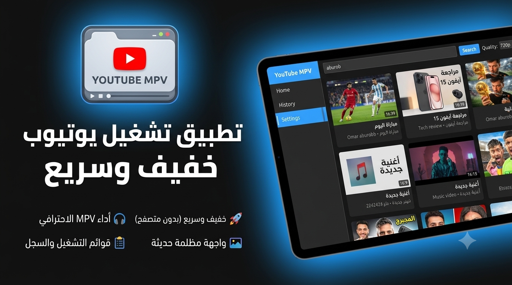

<div align="center">
  <h1>🎬 YouTube MPV Player Light</h1>
  <p><strong>A lightweight, privacy-focused desktop YouTube player</strong></p>
  <p>Stream YouTube videos directly — no browser, LOW-END use RAM , no ads, no API keys, no account required.</p>
<p align="center">
  
</p>
  <br>
</div>

---

## ✨ Features

- **🔍 YouTube Search** — Full-text search powered by yt-dlp with infinite scroll pagination
- **▶️ Video Playback** — Streams via MPV with quality selection (360p/480p/720p/1080p/best), including separate DASH video/audio tracks
- **🎛️ Playback Controls** — Pause/resume, seek, volume, stop, and restart from the now-playing bar or focus-aware keyboard shortcuts (Space / arrows / Escape never hijack text fields, sliders, buttons, or lists)
- **🔄 Reliable Resolution** — Async stream resolution with request cancellation so rapid clicks never start the wrong video
- **📜 Watch History** — Auto-saves watched videos (500 cap, dedup, async persistence)
- **📊 Analytics** — Local, per-profile watch time, videos played, rewatches, and most-watched channels; updates live after playback and can be reset (nothing is uploaded)
- **❤️ Likes & Watch Later** — Save and organize videos locally, with a dedicated Liked Videos page and live state indicators across Search, History, Playlists, and Home
- **📂 Playlists** — Create, rename, delete, and manage custom playlists (with built-in Watch Later), with selection preserved across updates
- **👤 Multi-Profile** — Separate profiles with independent settings, history, and playlists; failed switches keep the current profile intact
- **🛡️ Data Integrity** — Tolerant load-time validation repairs malformed JSON, rejects unsafe IDs, and keeps `.bak` recovery copies
- **🔒 Security Boundaries** — Thumbnail fetches are allowlisted and size-capped, yt-dlp ignores planted config files, avatars must be local files, and logs redact signed URLs and tokens
- **💾 Export / Import** — Versioned data bundles move a profile's settings, history, likes, playlists, and profile details between installs
- **🎨 Themes** — Default and YouTube-style dark themes applied application-wide, so dialogs, menus, and message boxes match
- **🪟 Window State** — Size, position, and maximized state are restored on launch and clamped to visible screens
- **🖼️ Thumbnail Caching** — LRU memory + disk cache with async loading
- **📋 Paste URL** — Direct playback from any YouTube URL
- **⚡ Performance** — Cached SVG icons, theme-based card styling, decoded-thumbnail cache, debounced async saves, O(1) video lookups, coalesced home-feed refreshes, smooth scrolling
- **🔌 No API Keys** — Fully local using yt-dlp (no Google Cloud, no OAuth)

---

## 🖼️ Screenshots

> *Coming soon — run the app to see it in action!*

---

## 🚀 Quick Start

### Prerequisites

- **Python 3.14+**
- **mpv.exe** ([Download](https://mpv.io/)) — Place in project root
- **yt-dlp.exe** ([Download](https://github.com/yt-dlp/yt-dlp)) — Place in project root

### Installation

```powershell
# Clone the repository
git clone https://github.com/raoufLR/YouTube-MPV-Player.git
cd YouTubeMpvPlayer

# Install Python dependencies
pip install -r requirements.txt

# Run the application
python main.py
```

> **First run** creates `User/` and `Cache/` directories automatically.
> Profile data lives under `User/profiles/<opaque-id>/`; existing `User/<name>/`
> directories are migrated automatically on startup.

### Build a Portable Executable

```powershell
pip install pyinstaller
python build.py
# Output: dist\youtube_video_player.exe (~107 MB, single file)
```

---

## 🏗️ Architecture

```
main.py → Application (composition root)
           ├── EventBus (thread-safe pub/sub)
           ├── ServiceContainer (DI with 14 services)
           └── MainWindow (PyQt6 UI)
               ├── SidebarWidget (navigation)
               ├── HeaderWidget (search + quality selector)
               └── Pages
                   ├── HomePage       — Personalized feed sections
                   ├── SearchPage     — Infinite-scroll search results
                   ├── HistoryPage    — Watch history with context menus
                   ├── PlaylistsPage  — Playlist CRUD with split panel
                   ├── LikedPage      — Liked videos with live updates
                   ├── AnalyticsPage  — Local playback statistics
                   └── SettingsPage   — Preferences with auto-save
```

### Services

| Service | Responsibility |
|---------|---------------|
| **LoggingService** | Centralized logging |
| **UserManagerService** | Multi-profile management |
| **SettingsService** | User preferences (quality, theme, volume, speed, etc.) |
| **PlayerService** | MPV lifecycle + cached playback state (position, duration, pause, volume) |
| **StreamResolverService** | yt-dlp resolution to direct media URLs (video + optional DASH audio) |
| **PlaybackService** | Async playback orchestration with newest-request-wins cancellation |
| **SearchService** | YouTube search via yt-dlp |
| **ThumbnailCacheService** | LRU memory + disk thumbnail cache |
| **UserProfileService** | Profile & avatar management |
| **HistoryService** | Watch history (event-driven, async flush) |
| **AnalyticsService** | Per-profile playback statistics (watch time, plays, rewatches, channels) |
| **LikesService** | Liked videos |
| **PlaylistService** | Playlists CRUD + Watch Later |
| **RecommendationService** | Video recommendations |

### Event Flow

```
User Action → Qt Signal → MainWindow → Service → EventBus → Subscribers
```

The app uses an **event-driven architecture** with 30 event types to decouple components. All UI updates are marshalled to the main thread via Qt signals.

---

## 📁 Project Structure

```
YouTubeMpvPlayer/
├── main.py                     # Application entry point
├── player.py                   # MPV subprocess wrapper (async IPC worker, DASH audio)
├── youtube_api.py              # yt-dlp wrapper (search + stream extraction)
├── build.py                    # Canonical build script
├── youtube_video_player.spec   # PyInstaller spec file
├── requirements.txt            # Python dependencies
│
├── app/                        # Application bootstrap & DI
│   ├── application.py          # Composition root
│   └── service_container.py    # 14-service DI registry
│
├── core/                       # Event system + shared helpers
│   ├── event_bus.py            # Thread-safe pub/sub with weak refs
│   ├── events.py               # 30 event dataclass types
│   ├── json_store.py           # Atomic JSON persistence with .bak recovery
│   ├── playback_errors.py      # Cancellation / resolution errors
│   ├── security.py             # URL/path validation, log redaction, file modes
│   └── quality.py              # Quality map + URL/video-id validation
│
├── services/                   # Business logic (14 services)
│
├── models/                     # Data models (4 dataclasses)
│   ├── playlist.py
│   ├── profile.py
│   ├── user_profile.py
│   └── user_settings.py
│
├── ui/                         # PyQt6 UI components
│   ├── main_window.py          # Main window with page stack
│   ├── sidebar_widget.py       # Navigation sidebar
│   ├── header_widget.py        # Search bar + quality selector
│   ├── now_playing_bar.py      # Mini player controls
│   ├── avatar_widget.py        # Profile avatar
│   ├── event_dispatcher.py     # Qt signal bridge
│   ├── icons.py                # SVG icon collection (cached renders)
│   ├── thumbnail_pixmaps.py    # Shared decoded-thumbnail cache
│   ├── status_bar_widget.py    # Status feedback (generation-safe messages)
│   ├── shortcuts.py            # Focus-aware playback key filter
│   ├── window_state.py         # Geometry restore/save with clamping
│   ├── themes/                 # ThemeManager system
│   ├── pages/                  # Page widgets
│   └── components/             # Reusable widgets (skeleton, video card)
│
├── tests/                      # Test suite (542 tests)
├── tools/                      # Development tools (performance benchmark)
├── User/                       # User data (profiles, settings, history)
│   └── profiles/<id>/          # Opaque per-profile directory
│       ├── profile.json        # Profile registry metadata
│       ├── user_profile.json   # Display name / avatar
│       ├── settings.json
│       ├── history.json
│       ├── likes.json
│       ├── analytics.json      # Local playback statistics
│       └── playlists/*.json
├── Cache/thumbnails/           # Thumbnail disk cache
├── mpv.exe / yt-dlp.exe       # Local binaries
│
├── BUILD.md                    # Build instructions
├── CHANGELOG.md                # Release history
├── PROJECT_MEMORY.md           # Detailed architecture docs
└── README.md                   # This file
```

---

## 🧪 Testing

```powershell
# Install development dependencies
pip install -r requirements-dev.txt

# Run all tests
python -m pytest -q

# Run with coverage
python -m pytest --cov --cov-report=term-missing

# Headless application/service smoke test
python main.py --self-test
```

The test suite covers the service layer, playback orchestration/cancellation, MPV IPC, application bootstrap, shutdown, entry-point behavior, and the Qt UI (pages, keyboard shortcut routing, window-state persistence, theming) with mocked yt-dlp/mpv subprocesses. CI runs the same checks on Windows.

Current baseline: **542 tests, 78.6% coverage, Ruff clean** (Python 3.14+ on Windows CI). Layout regressions found by the live UI smoke run are pinned by tests: home cards must not overlap after the skeleton→video transition, History/Liked lists must fill the page, Search must show its prompt on first load and after clearing, and home thumbnails delivered asynchronously must reach every card. Security boundaries are covered by `tests/test_security.py` and `tests/test_thumbnail_cache_service.py` (allowlist, redirects, size caps, path rejection, log redaction, atomic avatar copies); analytics by `tests/test_analytics_service.py` and `tests/test_analytics_page.py` (event pairing, repair, profile switching, reset, live refresh); rendering caches by `tests/test_icons.py` and `tests/test_thumbnail_pixmaps.py`.

UI performance has a repeatable harness:

```powershell
python tools/benchmark_perf.py            # table (median ms per operation)
python tools/benchmark_perf.py --json out.json
```

It runs offscreen, needs no network, and covers icon rendering, `VideoCard` construction, home-row population (cold and warm pixmap caches), thumbnail disk reads, EventBus publishing, and JSON persistence.

---

## 🔒 Security

All security boundaries live in `core/security.py`:

- **Network** — thumbnails may only be fetched from YouTube image hosts (`ytimg.com`, `youtube.com`, `ggpht.com`, `googleusercontent.com`) over http/https on ports 80/443, with no credentials, no private/loopback addresses, at most 3 manually re-validated redirects, `image/*` content types, and a 5 MiB cap.
- **Subprocesses** — every yt-dlp call passes `--ignore-config` (a config file next to the executable can otherwise inject `--exec`), `--no-playlist` for single videos, and closed stdin. The executable is resolved from the bundle or `PATH`, never the working directory.
- **Local files** — avatar sources must be plain local paths (no URLs, UNC/device paths, or Windows alternate data streams) and are copied atomically. JSON stores, backups, logs, and thumbnail caches are owner-only on POSIX.
- **Logging** — a redaction filter scrubs signed URL queries (`sqp`/`rs`), tokens, credentials, bearer/basic values, and control characters before anything reaches disk or the console.

> **Data is not encrypted at rest.** The previous `EncryptionService` was unreachable and stored its machine-derived key beside the data, so it was removed along with the `cryptography` dependency. Protection comes from per-profile directories, OS user ACLs, private file modes, and log redaction.

---

## 🛠️ Technologies

| Tech | Version | Purpose |
|------|---------|---------|
| [Python](https://www.python.org/) | 3.14 | Main language |
| [PyQt6](https://www.riverbankcomputing.com/software/pyqt/) | 6.11+ | GUI framework |
| [MPV](https://mpv.io/) | 0.41.0 | Video playback engine |
| [yt-dlp](https://github.com/yt-dlp/yt-dlp) | 2026.08.19 | YouTube search + streaming |
| [PyInstaller](https://pyinstaller.org/) | 6.22.3 | Executable packaging |
| [pytest](https://pytest.org/) | — | Testing framework |
| [requests](https://requests.readthedocs.io/) | — | Thumbnail HTTP downloads |

---

## ⚡ Performance

| Benchmark | Before | After | Reduction |
|-----------|--------|-------|-----------|
| 100 SettingsService.set() | 138.4 ms | 1.75 ms | **98.7%** |
| 10,000 EventBus publish | 3693 ms | 15.9 ms | **99.6%** |
| 100 `_update_item_display` | 18.9 ms | 0.61 ms | **96.8%** |
| SVG icon render (median) | 0.057 ms | 0.0002 ms | **99.6%** |
| `VideoCard` construction | 1.76 ms | 0.62 ms | **65%** |
| Home row populate, warm pixmaps (per card) | 4.28 ms | 1.30 ms | **70%** |

Optimizations include: debounced async saves, O(1) video lookup dict, item text cache, uniform item sizes, HTTP session pooling, batch thumbnail processing, and module-level constants. Milestone 7 added measured UI wins: SVG icons are cached per `(SVG, size)`, card labels are styled by the theme instead of five per-widget stylesheets, the hover drop shadow is created on demand and detached when idle, decoded/scaled thumbnails are shared through Qt's `QPixmapCache`, and home rows are built with updates disabled. A full home page (7 × 10 cards) builds in roughly 43 ms of card construction instead of 123 ms; re-populating it with cached thumbnails drops from ~300 ms to ~91 ms. First-load JPEG decoding still happens on the GUI thread (~1.5 ms per image), noted as a future improvement.

---

## 🤝 Contributing

Contributions are welcome! Here's how to get started:

1. Fork the repository
2. Create a feature branch (`git checkout -b feature/amazing-feature`)
3. Commit your changes (`git commit -m 'Add amazing feature'`)
4. Push to the branch (`git push origin feature/amazing-feature`)
5. Open a Pull Request

### Development Priorities

See [PROJECT_MEMORY.md](PROJECT_MEMORY.md) for the full TODO list and [CHANGELOG.md](CHANGELOG.md) for release history. Key areas:

- Search result caching
- Light theme stylesheet and playlist drag-and-drop reorder
- Auto-update for yt-dlp
- Off-thread decoding for cold-cache thumbnails

---

## 📄 License

This project is for personal and educational use. It uses:

- **[MPV](https://mpv.io/)** — GPLv2
- **[yt-dlp](https://github.com/yt-dlp/yt-dlp)** — Unlicense
- **[PyQt6](https://www.riverbankcomputing.com/software/pyqt/)** — GPLv3

---

## 🙏 Acknowledgements

- [yt-dlp](https://github.com/yt-dlp/yt-dlp) — YouTube streaming without API keys
- [MPV](https://mpv.io/) — The best video player
- [PyQt6](https://www.riverbankcomputing.com/software/pyqt/) — Python Qt bindings
- [PyInstaller](https://pyinstaller.org/) — Cross-platform executable packaging

---

<div align="center">
  <sub>Built with ❤️ for privacy-conscious YouTube viewers</sub>
</div>
